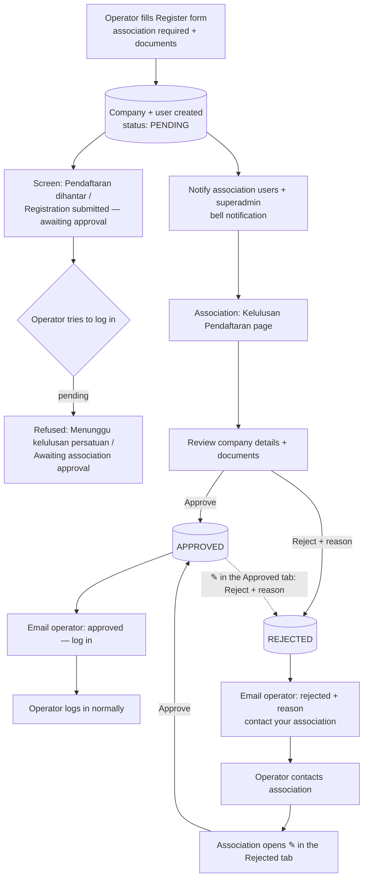

# Registration approval by association — feature plan

Status: **proposal for review** (2026-10-28). Decisions agreed — see the end.

Mockups in `docs/design/` (sample data; HTML source next to each):
- `registration-approvals-list-mockup.png` — Pending tab, ✎ button per row
- `registration-approvals-decided-mockup.png` — Rejected tab (Approved is the same without Reason), ✎ to change back
- `registration-approval-dialog-mockup.png` — ✎ pop-up: details + documents + Approve / Reject
- `registration-messages-mockup.png` — register / login messages, bell, dashboard card

## Why

Operator registration is open: anyone who fills the form gets a company and
an **active operator_admin account** at once, and can log in, create
products and take bookings under an association. Associations want to check
who joins them first — documents (MOTAC licence, trading licence, homestay
certificate) and that the business is really theirs.

## How it works today (checked in the code)

| Step | Today |
|---|---|
| Register (`POST /api/auth/register`, `authService.registerOperator`) | creates `companies` row + `users` row (role operator_admin, `association_id` from the form, `is_active` = true) in one transaction |
| Association on the form | required in the app, **optional on the server** (can be null) |
| Login | allowed straight away; only `is_active = false` is blocked (`assertAccountIsLoginEligible`) |
| Per-request check | `sessionService.loadCurrentState` re-checks the account on every request |
| Association users | role `association`, `association_id`, permission `association:manage_users`, own dashboard |
| Notifications | `notifications` table (user_id, user_type, title, message, type, related_id, is_read) + bell |
| Email | `emailService.sendMail` (SMTP, used by forgot password) |
| Local data | 77 companies; 3 operator_admins have no association |

## Workflow



Plain-text version:

```
Register ─► PENDING ─► association notified (bell) ─► review ─┬─► APPROVE ─► email ─► operator can log in
   │           │                                               └─► REJECT (reason) ─► email ─► operator contacts association
   │           │                                                      ─► association ✎ in Rejected tab ─► APPROVE
   │           │                                     (✎ in Approved tab can also REJECT later, reason required)
   │           └─ operator tries to log in ─► "Awaiting association approval"
   └─ success screen: "Registration submitted — awaiting approval"
```

### Statuses

| Status | Can log in? | Shown to other companies (package company list, stats)? |
|---|---|---|
| **pending** | no — "awaiting approval" message | no |
| **approved** | yes | yes |
| **rejected** | no — "rejected" message + reason | no |

Existing companies are set to **approved** by the migration — nothing
changes for current operators.

## Data model

Approval is about the **company** joining the association, so it lives on
`companies` (staff added later by an approved operator_admin are covered by
their company).

`companies` — new columns

| Column | Notes |
|---|---|
| `registration_status` | ENUM('pending','approved','rejected'), NOT NULL, default `'approved'` (so existing rows and admin-created companies are approved) |
| `registration_reviewed_by` | user id of the association user / superadmin who decided |
| `registration_reviewed_at` | when |
| `registration_rejection_reason` | text, required when rejecting |
| `registration_submitted_at` | when the operator (re)submitted — for "waiting n days" and sorting |

Registration sets `registration_status = 'pending'` explicitly.

Migration (self-contained, MySQL): add the columns with default `approved`;
backfill `registration_submitted_at = created_at`; index on
`registration_status`. Seeds the new permission (below).

## Backend

**Registration (`registerOperator`)**
- `associationId` becomes **required** (400 if missing / not found).
- Company created with `registration_status = 'pending'`.
- After commit: **bell notification** to the association's users and to
  superadmins (type `registration_pending`, `related_id` = company id). No
  email to the association.
- **No self re-registration after rejection:** the same email/username stays
  taken (409 *"… sila hubungi persatuan anda / please contact your
  association"*). The association re-approves it with ✎ instead.

**Login / session**
- `loginFromUnifiedUsers` + `assertAccountIsLoginEligible`: for operator
  users, load the company's `registration_status`:
  - pending → 403, code `REGISTRATION_PENDING`, *"Pendaftaran anda sedang
    menunggu kelulusan persatuan. / Your registration is awaiting approval
    from your association."*
  - rejected → 403, code `REGISTRATION_REJECTED`, message + reason.
- `sessionService.loadCurrentState`: same check per request (covers a
  company switched back to pending/rejected while someone is logged in).

**Approval API** (new `registrationApprovalRoutes` → controller → service →
policy → serializer, per CLAUDE.md)

| Method & path | Permission | Notes |
|---|---|---|
| `GET /api/registrations?status=pending` | `registration:approve` | association users: companies whose owner's `association_id` = theirs; superadmin: all (incl. no association) |
| `GET /api/registrations/:companyId` | `registration:approve` | company details, owner (name, username, email, phone), association, uploaded documents (signed/served URLs) |
| `POST /api/registrations/:companyId/approve` | `registration:approve` | from **pending or rejected**; sets approved + reviewer/time, clears the reason; emails the operator |
| `POST /api/registrations/:companyId/reject` | `registration:approve` | from **pending or approved**; reason required; emails the operator with it. Rejecting an approved company blocks its users on their next request (session check) |

Approving an already-approved / rejecting an already-rejected company → 400.
No edit endpoint — the association does not change the operator's details or
documents here.

Policy: an association user may act only on companies in **their**
association; superadmin on all.

**Hide unapproved companies** wherever companies are listed for others:
`companyService.getAllCompanies` / `getCompaniesByAssociationId` (package
company dropdown), association stats (`dashboardService.getAssociationStats`),
legacy/other company lists. Their own data isn't affected (they can't log
in until approved).

**Emails** (`emailService`, same style as password reset) — **to the
operator only** (they can't log in to see a bell):
- approved: "Akaun anda telah diluluskan — boleh log masuk / Your account is
  approved — you can log in".
- rejected: reason + "sila hubungi persatuan anda / please contact your
  association".

**Permission:** `registration:approve` — "Approve Operator Registration",
section Association; given to the **association** role; superadmin has it
through `*:*`. Seeded in the migration.

## Frontend

- **Register page:** association stays required (already `*`); success
  message changes to *"Pendaftaran berjaya dihantar. Akaun anda akan aktif
  selepas diluluskan oleh persatuan. / Registration submitted. Your account
  will be active once your association approves it."*
- **Login page:** show the pending / rejected messages (codes above) clearly
  instead of a generic error.
- **New page "Kelulusan Pendaftaran / Registration Approvals"** (menu for
  `registration:approve` — association users and superadmin):
  - tabs/filter: Pending (badge count) · Approved · Rejected;
  - list: company, owner, association, submitted date ("waiting n days");
    the Approved/Rejected tabs show decided date + by whom (and the reason
    on Rejected);
  - every row has a **✎ pencil button** (no separate detail page) that opens
    a pop-up with company details (business name, address, location,
    postcode, staff), owner (name, username, email, phone), **documents**
    (logo, MOTAC licence, trading licence, homestay certificate — open) and
    only two decision buttons: **Tolak / Reject** and **Luluskan / Approve**;
  - **Reject opens a second pop-up** on top: "Reject registration?" with a
    required **Reason** box and **Batal / Cancel** (back to the first
    pop-up) · **Hantar / Submit** (disabled while the reason is empty;
    rejects, emails the operator, closes both pop-ups);
  - the button matching the current status is greyed out, so ✎ in the
    Approved/Rejected tabs changes the decision back.
- **Bell:** association users and superadmin get "registration_pending"
  notifications that open the Pending tab (no email to them).
- **Association dashboard:** small "n pending registrations" card linking to
  the page.

## Edge cases

| Case | Handling |
|---|---|
| Existing operators | migration sets their companies to approved — no change |
| Registered without association (3 locally) | already approved; future registrations must pick one. Superadmin sees any pending one without an association and can approve it |
| Association has no users / nobody responds | superadmin approves from the same page (gets the same bell); pending list shows "waiting n days" |
| Rejected operator wants another try | contacts the association, which approves it with ✎ in the Rejected tab; registering again with the same email/username is refused with "contact your association" |
| Approved by mistake | ✎ in the Approved tab → Reject with a reason; the company's users are blocked |
| Offline | approval is online-only; registration already needs the network |
| Tourist registration | unchanged (no approval) |

## Phases

1. **Core:** migration + permission, pending on register, login/session
   block, approval API, approvals page, hide unapproved companies, emails,
   bell notification.
2. **Nice to have:** "request more documents" (status back to the operator
   to upload again), approval history log, reminder to the association after
   n days pending.

## Decided (2026-10-28)

| Question | Decision |
|---|---|
| Who approves | **Association users** (their association) **and superadmin** (all). |
| After rejection | Operator **contacts the association**, which approves it via ✎ — no self re-registration. |
| Approval UI | **✎ pencil per row → pop-up with Approve / Reject only** (no Edit button, no detail page); works from all three tabs so a decision can be changed back. |
| Documents | Stay **optional**. |
| Notify approvers | **Bell notification only** (no email to association / superadmin). Operator still gets an email with the decision. |
